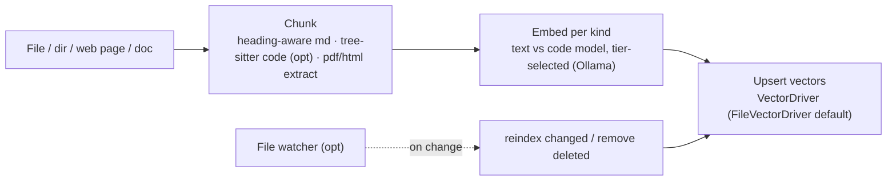
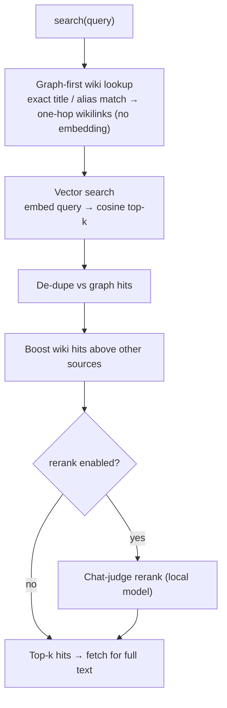

# Knowledge Base

Golem's local RAG layer: a per-project vector index over the documents you ingest
(codebases, docs, ADRs, fetched web pages), plus a **graph-first** lookup that lets
the committed [[Wiki-First Knowledge|wiki]] answer before similarity search ever
runs. Claude reaches it through the `search` / `fetch` / `ingest` MCP tools. Source:
`src/knowledge/knowledge-base.ts`, `src/mcp/search.ts`.

> **Local answers quote only durable prose:** the proxy's local answer (Decision 33)
> serves extractive quotes from indexed markdown but never from `docs/plan/`
> (working state) or `docs/marketing/` (unverified draft copy). Both stay ingested
> and searchable; the exclusion is `isProseSource` in `src/knowledge/local-answer.ts`.

> **Code vs spec:** spec §3.1 targets Qdrant; the shipped default is an on-disk
> `FileVectorDriver` (`src/knowledge/file-driver.ts`) — no server process, zero
> install friction — behind the same `VectorDriver` seam a Qdrant driver can later
> implement; the old `knowledge.vector_db_url` key is deprecated (accepted, ignored, warned
> once on load). **One collection per project** (no cross-project bleed). Without a
> configured embedder, `ingest`/`search` degrade rather than crash. `canonicalProjectId`
> collapses a project id to one identity — Windows path-spelling variants, and (as
> of 2026-08-22) a git worktree resolving to its main checkout — see
> [[CCR Ref Scope]] for the sibling decision this agrees with.

## Ingest path (write)

A file, directory, fetched page, or ingested doc is chunked, each chunk embedded by
the tier-appropriate model, and the vectors upserted. An optional file watcher
incrementally re-indexes on change (ADR-0001).

## Index freshness: the watch daemon and resumable builds (DUST2.14)

While `golem mcp serve` is up, `startKnowledgeWatch` (`src/cli/auto-index.ts`) runs one
**watch daemon** (`src/knowledge/watch-daemon.ts`) over the index roots (`knowledge.watch_paths`,
else the project) **and the wiki dir**, so a `wiki_upsert` or an editor save reaches the vector
index without a manual `ingest`. The server runs the session-start sync first and starts the
daemon after it. `GOLEM_KB_WATCH=off` disables it (a known switch, not an unknown setting). The
wiki stays the truth: the daemon only reads pages and writes the derived index.

- **One leader per project.** Only the session holding the lease (`.golem/state/kb-watch.lease`)
  polls and embeds. The lease is the vector store's own lockfile protocol (`acquireLock`: owner
  token, heartbeat, stale take-over with a token re-check). Followers do not poll; they retry
  every 30s, so a crashed leader is replaced, and the new leader runs a catch-up sync first. A
  leader that finds its lease taken demotes itself. `close()` releases it.
- **The wiki always has its own watcher.** It is small and the point of the feature, so it never
  depends on an outer root covering it: a project over the file cap, or a wiki under a dot-dir
  (which the outer scan will not walk), still has the wiki watched. A wiki outside the project
  is keyed `external:`.
- **Polling, bounded.** Same polling watcher on every OS (no native dependency; the pages it
  watches are the [[Wiki-First Knowledge|wiki]]). A cap of 5000 chunkable files per root and a
  walk limit of 10x that over ALL files (a bigger tree is not watched, with a log line; one that
  grows past it pauses until it shrinks), 2s poll, debounce, `node_modules`/`.git`/`dist`/`.golem`
  and dot-dirs pruned, one stat per file per scan. Every timer is unref'd and `mcp serve` closes
  the daemon and exits on stdin EOF, transport close, or SIGTERM/SIGINT/SIGHUP, so a
  disconnected client never leaves an orphan. Pending work is keyed by path, so an event storm
  or a rename-over-existing settles on the final state; one apply at a time, deletions first,
  slices of 20 files.
- **Never loses a page to a failed edit.** `reindexFiles` embeds before it deletes, so a down
  embedder keeps the old chunks. An unreadable file (EBUSY/EPERM) is a failed path
  (`PartialReindexError`): its old chunks stay and it is never recorded as indexed. Failed paths
  are retried with capped exponential backoff (2s up to 60s, 8 tries, then logged and dropped);
  a newer save supersedes a pending retry.
- **Never writes into another build's index.** Before any apply the daemon compares the
  manifest's embedder signature with its own and halts (one log line, lease released) on a
  mismatch or a newer manifest format; an unreadable manifest just requeues. The manifest
  recorder checks the signature too. A file the manifest already records at the same stat
  (another session did it) is skipped.
- **Never throws into the host.** Every failure is counted (`daemon.stats.errors`), logged, and
  swallowed. Shutdown closes watchers, clears timers, drops queued work and waits for the apply
  in flight.
- **Never reads outside a root.** Each changed path is re-resolved with `realpath.native` and
  dropped unless still inside its root's real path.
- **Checkpoints.** The manifest (`manifest.json` beside each collection) is **versioned**
  (`version: 1`), written atomically (`replaceViaTemp`) and validated on read. Only a readable
  file that fails to parse or validate is discarded (logged) and the collection rebuilt; an
  *unreadable* manifest (a transient Windows lock) skips the sync, and a *newer-format* one is
  never wiped or written over (a newer golem owns it). The first build starts from an empty
  manifest marked `building: true` and runs the same checkpointed sync (deletions first, then a
  checkpoint every 20 files); a rerun after a kill continues it **uncapped** (the auto-index cap
  does not apply to an unfinished build), and the marker clears when it finishes. Files that
  could not be read are left out of the recorded map so the next sync retries them.

See [[Auto-Index Cost]] for what the session-start sync spends.

## Search path (read) — graph-first, then vector

`assembleHits` (`src/mcp/search.ts:207`, module-local; moved out of `server.ts` by the R8.28 split) is the one place hit assembly lives, shared by
the `search` tool and the `coder` tool's grounding. It tries a cheap, precise
**wiki title or alias match** (and one hop along that page's `[[wikilinks]]`) with **no
embedding call**, then always runs vector search too, de-dupes, boosts wiki hits
above other sources, and optionally reranks with a local chat-judge.

`graphFirstWikiHits` (`src/mcp/search.ts`) is re-exported from `src/mcp/server.ts`
but lives in `search.ts`.

**Aliases (DUST2.15).** A page's frontmatter `aliases: [PC, Cache Warmup]` (a bracketed
list or one bare scalar; optional, parsed by `src/wiki/frontmatter.ts`, never written by
`wiki_upsert` but kept verbatim on rewrite) is matched like a title: case-insensitive,
trimmed, blanks and repeats ignored. Order is deterministic: the title match first, then
every alias match in `relPath` order — an alias shared by two pages surfaces **both**.
A `[[wikilink]]` in the one-hop step may name an alias too (a title wins over an alias,
the first `relPath` wins between aliases). Tables are built in one pass, so a large wiki
costs O(pages + links). An alias hit scores 1.9, under an exact title (2) and over a
linked page (1.6). The title-collision rule below is unchanged. On a title collision between the project wiki and the
user-scope wiki, graph-first builds its title map with `Map.set` over a page list that
puts user pages last, so the **user page wins** (`search.ts:172-173`,
`federated-wiki-reader.ts:39`); `readPage`/`resolveLink` still prefer the project page.
The two paths disagree and that is left open (audit contradiction D1); see
[[Wiki-First Knowledge]].

Graph-first is **purely additive**: a free-text query that names no page just skips
straight to vector search, so nothing regresses. This is why keeping the wiki current
pays off directly — see [[Wiki-First Knowledge]].

## Embedder identity on build

A build never silently narrows an existing index. `planBuildEmbedder`
(`src/cli/auto-index.ts:328`) compares the embedder recorded in the manifest with the
one the detected hardware tier would use, and returns one of four plans:

- `use-current` — no semantic index yet, or the tier's model built it.
- `pin` — keep the existing index's model, because the tier's would narrow the vectors
  (a degraded capability probe must not trigger a full re-embed at 768 in place of 1024).
- `reembed` — the whole index is re-embedded into another space (a wider model is now
  available, or the original is gone); a notice says so.
- `lexical` — no semantic model is available; the built-in lexical embedder is used,
  with a notice that retrieval is weaker.

Underneath, `EmbedderMismatchError` (`src/knowledge/driver.ts:42`) rejects a query whose
vector width differs from a non-empty index, and `FileVectorDriver.upsert` resets the
collection when incoming vectors have a new width (`src/knowledge/file-driver.ts:196-209`).
Cost side: [[Auto-Index Cost]].

## Scopes and federation

`search` can span more than the project index:

- **knowledge** (default) — the project's own vector index (code, docs, and pages
  fetched via [[Web Cache]]).
- **memory** (opt-in) — Headroom's conversational memory, via the optional Python
  sidecar (Decisions 13/18). Absent it, search silently degrades to knowledge-only.
- **user-scope wiki** — `~/.golem/wiki/` federated read-only across projects.

Hits from every active scope are merged, sorted by score, and truncated to *k*. Full
text for any hit comes back through `fetch` (`getChunk`), so Claude pulls ~2–5K
tokens of relevant chunks instead of reading whole directories.

## `fetch` coverage and safety

`fetch(chunk_id)` resolves every hit kind `search` returns:

- **Stored chunks** (ingested trees, cached web pages) — `getChunk` on the vector store,
  looked up by the opaque id only. A chunk's `source_path` may be `external:<abs path>`
  (an index target outside the project); it is data, never joined to a base or read from
  disk by `fetch`.
- **Graph-first wiki hits** (`wiki:<relPath>`, `user:`-prefixed for the user wiki) —
  read from the wiki store. An id with `..`, an absolute or drive path, a backslash or NUL is
  refused before the store sees it, and the store refuses anything escaping the wiki dir.
- **Memory-scope hits** (`memory:<id>`) — Headroom has no lookup by id, so the server keeps
  the last 200 memory hits `search` returned and serves the full text from that; an id
  `search` never returned is a clear error.

Anything missing or refused answers `Unknown chunk "<id>"` as an error result, never a crash.

See [[Architecture]] for how the KB sits beside the proxy and inference router, and
[[Distillation Pipeline]] for how raw captures become durable, linkable pages.
